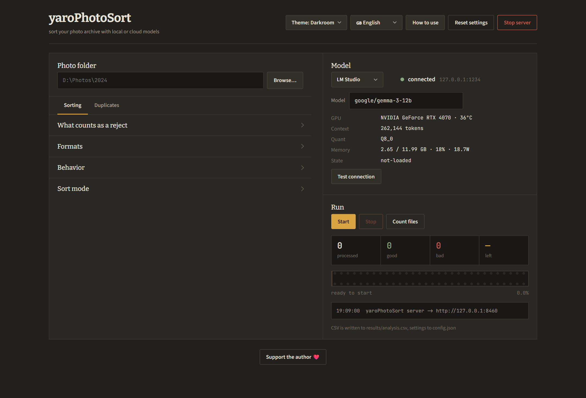
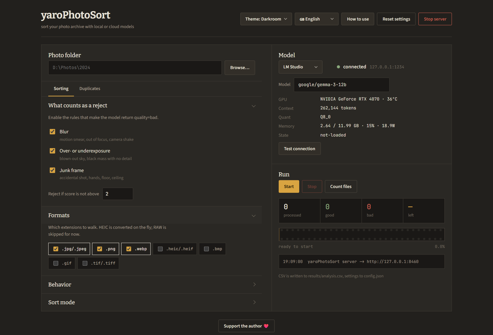
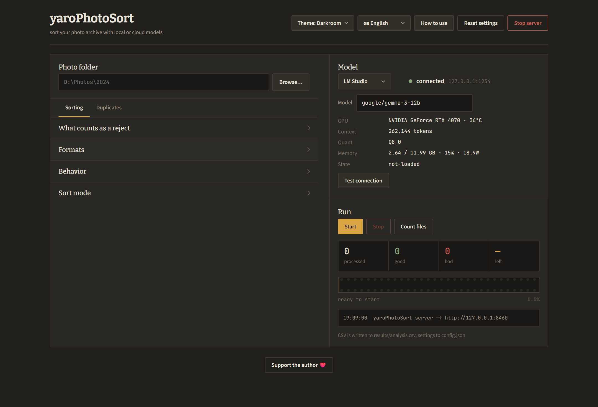
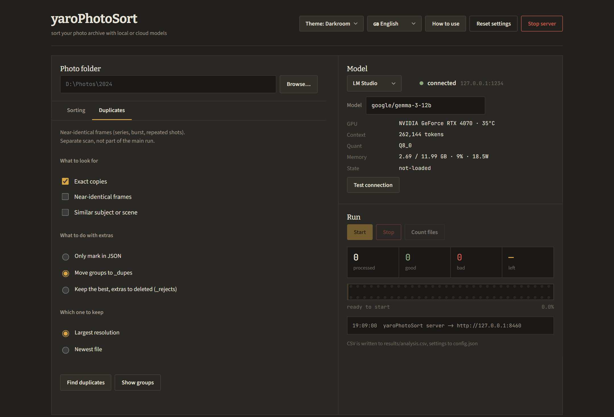
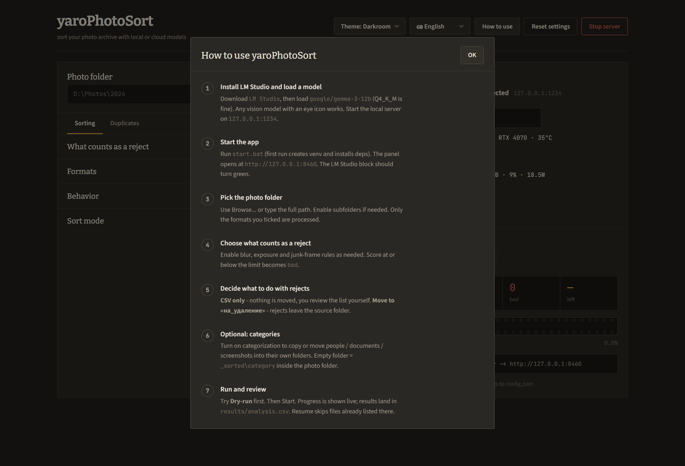
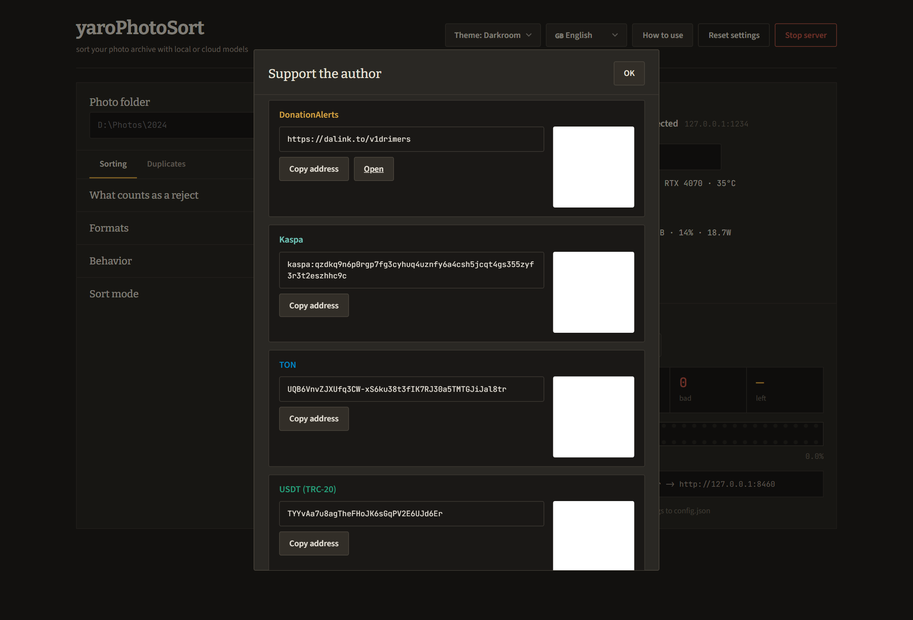

# yaroPhotoSort

**Languages:** 🇬🇧 [English](README.md) · 🇷🇺 [Русский](README.ru.md)

A local panel for cleaning up a large photo archive: flags rejects and sorts shots into folders using a vision model — locally (LM Studio / Ollama) or in the cloud (ChatGPT, Claude, Gemini, Qwen, MiMo, NVIDIA, OpenRouter).

Built for this job: ~15,000 personal photos, quickly separate blurred / blown-out / accidental frames and distribute the rest (people, documents, screenshots, etc.) into folders. Local models run on your own GPU with no tokens spent; cloud providers are optional when you want a bigger model.

---

## Screenshots

### Main panel (English)



Sorting settings open as accordion sections, duplicates live in their own tab.

### Settings accordion



### Model provider and GPU



Local providers show GPU name, temperature, VRAM, utilization and power draw.

### Duplicates tab



### Help



### Support the author




## How it works

```
photo folder ──► server.py ──► LM Studio (gemma-3-12b) ──► JSON verdict
                  │                                            │
                  ├─ results/analysis.csv  ◄───────────────────┤
                  ├─ _rejects/             (if enabled)        │
                  └─ _sorted/<category>/   (if enabled) ────────┘
```

1. Pick a photo folder in the browser panel.
2. The server walks the files, downscales each photo and sends it to the selected model.
3. The model replies with JSON: quality (`ok`/`bad`), reason, score 1–5, content category.
4. Results go to CSV; rejects can be moved to deleted (`_rejects`), categories/events can be copied or moved into their own folders.
5. An interrupted run can be resumed: paths already in the CSV are skipped.
6. Borderline shots can wait in a review queue where you decide keep or delete.
7. Every file move is journaled — undo one file or a whole run.
8. A separate duplicates tab finds exact copies, burst frames and similar scenes.

---

## Requirements

| What | Why |
|---|---|
| **Python 3.10+** | backend |
| **A vision model** — LM Studio / Ollama locally, or a cloud API | photo analysis |
| **GPU with ~8–12 GB VRAM** (comfortable on RTX 4070-class) | smooth vision inference |
| Python packages from `requirements.txt` | FastAPI, uvicorn, requests, pillow, pillow-heif |

The first `start.bat` run creates `venv` and installs packages by itself.

## Model providers

The **Model** block on the right side switches where photos are sent. Sorting rules stay the same for every provider.

| Provider | Where it runs | Auth |
|---|---|---|
| **LM Studio** | local, default `127.0.0.1:1234` | none |
| **Ollama** | local, default `127.0.0.1:11434` | none |
| **Google Colab** | your own GPU in a notebook | Base URL of the tunnel |
| **ChatGPT** | OpenAI cloud | `OPENAI_API_KEY` |
| **Claude** | Anthropic cloud | `ANTHROPIC_API_KEY` |
| **Gemini** | Google AI Studio | `GEMINI_API_KEY` |
| **Qwen** | Alibaba DashScope | `QWEN_API_KEY` |
| **MiMo** | Xiaomi cloud | `MIMO_API_KEY` |
| **NVIDIA** | build.nvidia.com / NIM | `NVIDIA_API_KEY` |
| **OpenRouter** | aggregator | `OPENROUTER_API_KEY` |

Keys are stored in `.env` in the project folder (copy `.env.example` to `.env`). The **Test connection** button checks the endpoint and fills the model list.

Cloud providers also track request count, token usage and estimated spend, with optional limits.


### LM Studio

1. Open LM Studio.
2. Load **google/gemma-3-12b** (Q4_K_M is fine) or another vision model.
3. Start the local server on `http://127.0.0.1:1234` (Server → Start).

The panel shows live status: server reachability, model name, context, quant, GPU memory.

> Text-only models without a 👁 (vision) badge cannot take images.

---

## Install and run

### 1. Quick start

Double-click **`start.bat`**:

- creates `venv` (if missing) and installs dependencies
- starts the server
- opens the panel in your browser at `http://127.0.0.1:8460`

Stop: close the console window.

### 2. “Start server” button in the HTML

To let the page launch a terminal, run **`install.bat`** once.

It registers the `yarophoto://` protocol under HKCU (no admin) using the **current** project path, and writes `register-yarophoto.reg` for reference:

```
yarophoto://start   — start the server (or open the panel if it is already running)
yarophoto://stop    — stop the server
yarophoto://open    — open the panel in the browser
```

Handler chain: `launch-hidden.vbs` → `launch.ps1`. No arbitrary commands are allowed — only the three above.

> If you move the project folder, run `install.bat` again; the path is rewritten automatically.

### 3. Manual start

```bat
cd path\to\yaroPhotoSort
venv\Scripts\activate
python server.py
```

### Why port 8460, not 8000

Port 8000 often falls into reserved Windows ranges (Hyper-V, etc.) and will not bind. Default port is **8460**. To change it:

```bat
set YAROPHOTO_PORT=9000
python server.py
```

(also update the URL in `start.bat` and the panel’s “Open panel” button)

---

## Panel: what goes where

### Photo folder

Full path to the directory to process:

- **Browse…** — system folder dialog
- **Type it in** + Enter
- **Drag & drop** — only when the browser exposes the path (Chrome/Edge); Firefox does not, use Browse…

Subfolders are walked recursively (can be disabled). Video and RAW are not processed.

### Formats

Which extensions count as photos: `.jpg/.jpeg`, `.png`, `.webp`, `.heic/.heif`, `.bmp`, `.gif`, `.tif/.tiff`.

- HEIC/HEIF is converted on the fly (needs `pillow-heif`)
- RAW (CR2/NEF/ARW, …) is skipped in the current version

### What counts as a reject

Rules the model uses for `quality=bad`:

- blur
- over- or underexposure
- junk frame (accidental shot, hands, floor, ceiling)

Threshold: **reject if score ≤ N** (default 2; scale 1–5, 5 is best).

### What to do with rejects

- **CSV only** — nothing is moved, you review the list yourself
- **Move to deleted (`_rejects`)** — folder is created inside the photo folder

### Categories and folders

The model tags content: people, documents, screenshots, food, landscape, animals, transport, interior, other.

The path in a category row is **hybrid**:

| «Folder» value | Destination |
|---|---|
| empty | `<photo folder>\_sorted\<category>` |
| relative (`_sorted/people`) | `<photo folder>\_sorted\people` |
| absolute (`E:\Sorted\People`) | `E:\Sorted\People` |

Action: `copy` / `move` / `leave alone`. Unchecking a row (or the master switch) disables its path and action.

Optionally keep the source subfolder layout when copying.

### More

- **Resume** — skip files already listed in the CSV
- **Dry-run** — score and write CSV, never move or copy
- **Reason in filename** — when moving rejects: `IMG_1823_bad_blur.jpg`

---

## Project files

| File | Role |
|---|---|
| `server.py` | backend: API, folder walk, LM Studio calls, CSV, copy/move |
| `index.html` | control panel (single file, static + JS) |
| `locales/en.js`, `locales/ru.js` | UI translations (loaded by the page; works from `file://` too) |
| `start.bat` | start server + open browser |
| `install.bat` | one-shot `yarophoto://` registration (generates `.reg` for the current path) |
| `register-yarophoto.reg` | generated by `install.bat`, not in git |
| `launch.ps1` | `yarophoto://start\|stop\|open` handler |
| `launch-hidden.vbs` | runs `launch.ps1` without a PowerShell window |
| `requirements.txt` | Python dependencies |
| `LICENSE` | CC BY-NC-ND 4.0 |
| `config.json` | saved settings (created by the panel, not in git) |
| `results/analysis.csv` | parse results (not in git) |
| `results/run.log` | run log (not in git) |

---

## UI languages

The panel ships in English (default) and Russian. Switch with the language button in the header — the choice is stored in `localStorage`. Server logs and CSV stay in English.

## Themes

A header dropdown switches **Darkroom** (graphite + safelight amber) and **Paper** (warm paper + red grease pencil). Choice is stored in `localStorage`.

---

## CSV format

`results/analysis.csv`:

```
path, filename, quality, quality_reason, score, category,
category_confidence, action, error, sec, ts
```

- `quality` — `ok` / `bad`
- `score` — 1–5
- `action` — what was done (or `csv_only`)
- `error` — error text if the file failed

A rerun with Resume reads this file to learn which paths are already done.

---

## API (for debugging)

| Method | Path | Purpose |
|---|---|---|
| GET | `/` | panel |
| GET | `/api/ping` | health check |
| GET | `/api/config` | current settings |
| POST | `/api/config` | save settings |
| POST | `/api/browse-folder` | system folder dialog |
| GET | `/api/scan` | how many files match the filters |
| GET | `/api/lmstudio` | LM Studio status |
| POST | `/api/start` | start a run |
| POST | `/api/stop` | stop after the current file |
| GET | `/api/status` | progress + log tail |
| POST | `/api/shutdown` | stop the server |

---

## Layout after a run (example)

```
D:\Photos\2024\
├── ... sources ...
├── _rejects\
│   └── IMG_1823.jpg
└── _sorted\
    ├── people\
    ├── docs\
    └── screenshot\
```

---

## Limitations

- Firefox does not expose a dropped folder’s full path — use Browse… or type it
- Verdict quality depends on the model; gemma-3-12b is enough for an archive, not production-grade
- RAW is not parsed
- One run at a time (a second start is refused)

## License

This project is licensed under **CC BY-NC-ND 4.0**.
See [LICENSE](LICENSE) for details.
